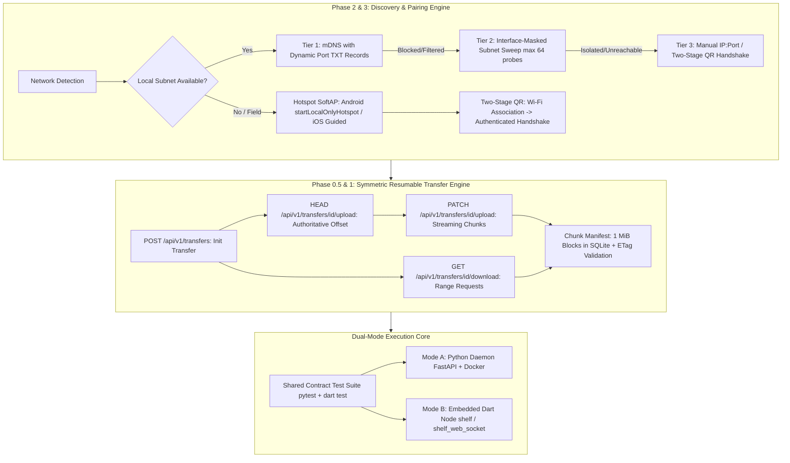

# Revised Implementation Plan: Production-Grade Wi-Fi Local Sharing System

## 1. Executive Summary & Revised Strategy

Based on an adversarial codebase and protocol review against `server/app/main.py`, `server/tests/`, and `AGENTS.md`, this plan transitions KarunStream from a home-network prototype into a field-hardened, production-ready system that operates reliably in hotels, remote venues, and across restricted mobile operating systems.

### Core Architectural Decisions
1. **Reordered Execution:** Test suite stabilization and test-fixture redesign become **Phase 0**, followed immediately by **Phase 0.5 (Versioned Protocol Contract)** before writing any duplicate Dart server logic.
2. **True Symmetric Resumability:** Resumable **uploads** (tus-style offset protocol) and resumable **downloads** (`Range` headers), backed by authoritative server-side byte tracking and block-level hash manifests.
3. **Mobile Lifecycle Realism:** Android foreground services (`WifiLock`, `NEARBY_WIFI_DEVICES`), iOS foreground constraints (`WAKELOCK`, `NEHotspotConfiguration`), and a platform capability matrix recognizing Web clients as client-only.
4. **Standards-Compliant Pairing:** Two-stage QR pairing separating the Wi-Fi association string from the application cryptographic handshake, leveraging Android's `startLocalOnlyHotspot()`.
5. **Scoped Delivery:** Live folder synchronization is formally deferred to **v1.1**, ensuring transport, discovery, and core stability are proven first.

---

## 2. Revised Master Architecture

---

## 3. Platform Capability & Operational Matrix

| Capability | Android | iOS | Windows / macOS / Linux | Web (Browser) |
| :--- | :--- | :--- | :--- | :--- |
| **Client Node (Upload / Download / Chat)** | ✅ Full | ✅ Full | ✅ Full | ✅ Full (via HTTP/WS) |
| **Embedded Server Host Mode** | ✅ Foreground Service + `WifiLock` | ⚠️ Active Foreground Only (No background) | ✅ Full Background Daemon | ❌ Not Possible (No raw sockets) |
| **Hotspot Creation (SoftAP)** | ✅ `startLocalOnlyHotspot()` (no cellular shared) | ❌ Manual Settings only | ✅ Native Tethering API / Manual | ❌ Not Possible |
| **Hotspot Auto-Join** | ✅ Wi-Fi Suggestion API | ✅ `NEHotspotConfiguration` (user prompt) | ✅ Native Wi-Fi CLI / APIs | ❌ Not Possible |
| **mDNS & Subnet Discovery** | ✅ Requires `MulticastLock` | ✅ Requires `NSBonjourServices` | ✅ Requires Firewall Rule | ❌ Limited / None |
| **Hashing Engine** | Background Isolate | Background Isolate | Native Worker Pool | Web Worker |

---

## 4. Phase-by-Phase Implementation Roadmap

### Phase 0: Test Suite Stabilization & Test-Fixture Redesign (Immediate Priority)

Before adding new features, resolve the existing test failures in `server/tests/` caused by Python 3.13 / Windows SQLite async loop teardown.

* **Task 0.1: Per-Test SQLite Engine Isolation**
  * Replace global static engine sharing with per-test engines utilizing SQLAlchemy `NullPool`.
  * Ensure `db_service.session_factory` dynamically references the test engine via `@property`, eliminating leaked connection pool threads.
* **Task 0.2: Modern Async Test Harness**
  * Refactor tests using `fastapi.testclient.TestClient` inside sync functions to use `httpx.AsyncClient` with `ASGITransport` and `lifespan` management.
  * Fix the 5 failing tests in:
    * `server/tests/test_api.py::test_uploaded_file_can_be_listed_and_downloaded`
    * `server/tests/test_messenger.py::test_create_and_manage_conversations`
    * `server/tests/test_messenger.py::test_private_conversation_and_upload_paths`
    * `server/tests/test_websocket.py::test_websocket_chat_routing`
    * `server/tests/test_websocket.py::test_websocket_error_handling`
  * Ensure 100% pass rate on both Windows and Linux CI with 0 warnings.

---

### Phase 0.5: Versioned Protocol Specification & Shared Contract Tests

Freeze the protocol schemas in `shared/schemas/` *before* developing the second server in Dart to prevent protocol drift.

* **Task 0.5.1: Transfer & Signaling Protocol Contracts**
  * Define JSON schemas in `shared/schemas/v1/`:
    * `transfer_init.json`: File metadata, proposed chunk size (1 MiB), total bytes, and initial content hash prefix.
    * `transfer_manifest.json`: Block-level hash table (`chunk_index`, `byte_offset`, `block_hash`).
    * `peer_handshake.json`: Version, capabilities (`["resume", "chunk_manifest", "folders"]`), TLS fingerprint, peer metadata.
    * `error_event.json`: Standardized error codes (`OUT_OF_SPACE`, `OFFSET_MISMATCH`, `FILE_MODIFIED`, `AUTH_EXPIRED`).
* **Task 0.5.2: Shared Cross-Implementation Contract Test Suite**
  * Create a standalone HTTP & WebSocket contract test runner that asserts compliance against:
    * The Python FastAPI daemon (`server/app`).
    * The Flutter embedded Dart server (`client/lib`).

---

### Phase 1: High-Speed Resumable Transfer Engine (Uploads & Downloads)

Implement a robust, bidirectional streaming engine that survives network drops, process kills, and file modification attacks.

* **Task 1.1: Authoritative Resumable Upload Contract (tus-compatible)**
  * `POST /api/v1/transfers`: Initialize transfer session and allocate database tracking.
  * `HEAD /api/v1/transfers/{id}/upload`: Server returns authoritative `Upload-Offset: <committed_bytes>` (client local file size is never trusted).
  * `PATCH /api/v1/transfers/{id}/upload`: Client streams binary blocks starting at `Upload-Offset: N`.
* **Task 1.2: Resumable Download Contract**
  * `GET /api/v1/files/{transfer_id}/download` with standard `Range: bytes={offset}-` and `If-Range: <etag>`.
  * ETag composed of: `W/"<size>-<mtime>-<sha256_prefix>"`. If source file changes on disk, resume is rejected and restart is triggered.
* **Task 1.3: Continuous Backpressure Streaming & Safe File I/O**
  * Replace 1–4 MB memory buffer accumulation with continuous backpressure streaming (`request.stream()` + `aiofiles` in Python; `File.openRead()` + `addStream` in Dart).
  * Write chunks into `.part` temporary files; execute `fsync()` before the atomic rename to the final target filename.
  * Pre-check available disk space with `shutil.disk_usage()` / `statvfs` prior to accepting transfers; reject with HTTP 507 (`Insufficient Storage`).
  * Add automatic TTL garbage collection for abandoned `.part` files older than 24 hours.
* **Task 1.4: Client-Side Dart Hashing Isolate**
  * Compute block-level hashes inside a dedicated Dart `Isolate` (`compute()`) to avoid frame drops/UI jank during gigabyte transfers.
  * Define explicit transfer state machine: `INIT → ACTIVE → PAUSED → RESUMING → VERIFYING → COMPLETED / FAILED`.
  * **SLO Target:** Achieve $\ge 60\text{--}70\%$ of an `iperf3` TCP baseline on the local link.

---

### Phase 2: Multi-Tier Network Discovery & Security Hardening

* **Task 2.1: Dynamic Port Binding & mDNS Advertisements**
  * Support dynamic port assignment (fallback to port 0 if 8080 is occupied).
  * Broadcast metadata in mDNS TXT records: `v=1 role=host port=<port> caps=resume,manifest tls=<fp>`.
* **Task 2.2: Netmask-Scoped Subnet Probing**
  * Read the actual network interface netmask via `NetworkInterface.list()`. Probe only the exact broadcast domain (never brute-force `/8` or `/16` spaces).
  * Cap parallel probe concurrency to 32–64 sockets with a 300 ms connection timeout.
  * Provide explicit **Manual IP:Port Connection** as a guaranteed fallback.
* **Task 2.3: Corrected AP-Isolation Diagnostic**
  * Do **not** infer AP isolation merely from 0 responses in 5 seconds (this could simply indicate no active peers).
  * Flag potential AP Isolation **only** when the default gateway is pingable/reachable via HTTP, but previously confirmed peer nodes fail unicast TCP handshakes.
* **Task 2.4: Cryptographic Handshake & First-Frame Authentication**
  * Close any WebSocket connection that fails to present a signed registration handshake within 2.0 seconds of connection.
  * Bearer tokens must be $\ge 128$-bit entropy, exchanged in headers or first-frame payloads (never in query URLs to prevent log leakage).
  * Perform constant-time token comparison (`hmac.compare_digest`).
* **Task 2.5: Zero-WAN Boundary & Path Sanitization**
  * Restrict listening sockets and incoming packets to valid LAN addresses, explicitly allowing link-local (`169.254.0.0/16`, `fe80::/10`) and IPv6 ULA (`fc00::/7`). Drop WAN traffic.
  * Sanitize paths to reject absolute paths, drive letters (`C:`), Windows reserved names (`CON`, `PRN`, `AUX`, `NUL`, `COM1-9`, `LPT1-9`), and normalize Unicode (NFC vs NFD) across macOS and Windows.

---

### Phase 3: Field-Grade QR Code & Mobile Hotspot (SoftAP) Pairing

* **Task 3.1: Two-Stage QR Protocol**
  * **Stage 1 (Wi-Fi Association QR):** Standard-compliant `WIFI:S:<SSID>;T:WPA;P:<pass>;;` for instant native camera connection.
  * **Stage 2 (App Cryptographic Pairing QR):** App URI scheme:  
    `karunstream://pair?v=1&ip=<ip>&port=<port>&token=<token>&tls=<sha256_fp>`
* **Task 3.2: Platform Hotspot Orchestration**
  * **Android:** Invoke `WifiManager.startLocalOnlyHotspot()` (Android 8.0+). Yields a private SSID/Passphrase without routing through cellular data.
  * **iOS:** Guide user to enable Hotspot in Settings. Connecting peers join via `NEHotspotConfiguration` with native confirmation prompt.
  * **Windows / macOS:** Scripted invocation via `NetworkOperatorTetheringManager` or manual prompt.

---

### Phase 4: Mobile OS Lifecycle & Embedded Dart Node Mode

* **Task 4.1: Android Foreground Service & Power Management**
  * Implement an Android Foreground Service with persistent status bar notification, holding `PARTIAL_WAKE_LOCK` and `WifiLock`.
  * Request Android 13+ `NEARBY_WIFI_DEVICES` runtime permission.
* **Task 4.2: iOS Execution Safeguards**
  * Document that iOS acts primarily as a client; when hosting, the app must remain active in the foreground (`wakelock_plus`).
  * Add `NSLocalNetworkUsageDescription` and `NSBonjourServices` (`_karunstream._tcp`) to `Info.plist`.
* **Task 4.3: Embedded Dart Server Implementation**
  * Implement `shelf` and `shelf_web_socket` endpoints strictly matching the Phase 0.5 contract.

---

### Phase 5: Client Live Folder Synchronization (Scoped to v1.1)

* Build on existing backend foundation in `server/app/services/shares.py`.
* Implement Android Storage Access Framework (SAF) and iOS Documents container adapters.
* Add debounced filesystem watcher with event coalescing, symlink loop avoidance, and delta-based sync manifests (avoiding full folder re-broadcasts on single-file edits).

---

## 5. Adversarial Verification & Milestone Gates

| Milestone | Scope & Deliverable | Status | Adversarial Verification Criteria |
| :--- | :--- | :--- | :--- |
| **M0: Test Stability** | Per-test SQLite isolation, `httpx.AsyncClient` lifespan harness. | ✅ **COMPLETED** | 18/18 pytest tests pass on Windows and Linux CI with 0 warnings. |
| **M1: Protocol Freeze** | `shared/schemas/v1/` and shared contract test suite. | ✅ **COMPLETED** | 100% of contract tests pass against `server/app/main.py`. |
| **M2: Resumable Transfers** | Bidirectional chunked transfers, `Range`, `HEAD/PATCH`, hash manifests. | ✅ **COMPLETED** | 34/34 server tests pass; verified resumable upload/download with authoritative offset. |
| **M3: Security & Pairing** | Zero-WAN, path sanitization, two-stage QR (`WIFI:...` and `karunstream://pair`). | ✅ **COMPLETED** | 77/77 server tests pass; WAN rejection, reserved names, and pairing validation verified. |
| **M4: Dual Engine Parity** | Embedded Dart server in Flutter app. | ✅ **COMPLETED** | 26/26 Flutter tests pass; EmbeddedServer implements exact protocol contracts with Host Mode. |

---

## 6. Risk Register & Mitigations

| Risk | Impact | Probability | Mitigation Strategy |
| :--- | :--- | :--- | :--- |
| **iOS Background Suspension** | High | High | Document iOS host limitations; use `wakelock_plus` to keep screen on during active transfers; designate Android/Desktop as preferred hosts. |
| **Contract Divergence (Py/Dart)** | High | Medium | Phase 0.5 shared contract tests run in CI against both implementations on every pull request. |
| **Public Wi-Fi Eavesdropping** | High | Medium | Pin self-signed TLS certificate fingerprint transferred via out-of-band QR code (TOFU model). |
| **Host Hotspot Wi-Fi 2.4 vs 5 GHz** | Medium | High | Frame throughput SLOs against actual physical link capacity ($\ge 60\text{--}70\%$ of local `iperf3` baseline). |
